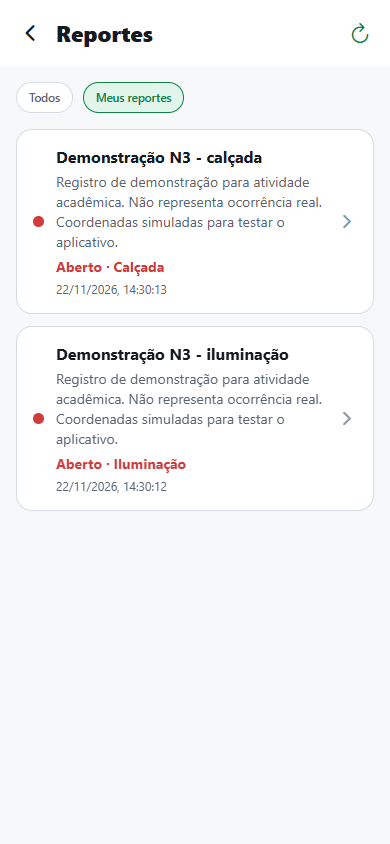

# Validação com Firebase real

Em **22/11/2026**, o aplicativo foi testado no navegador contra o projeto **falacidade-vnn7-n3**, usando os serviços reais de Authentication e Firestore.

O teste criou uma conta de demonstração por e-mail/senha e enviou dois reportes pelo formulário. As gravações usaram a sessão do cliente e passaram pelas regras publicadas; não foram inseridas com credencial administrativa.

| Registro | Coordenadas simuladas | Horário de Cuiabá |
| --- | --- | --- |
| Demonstração N3 - iluminação | -15.600000, -56.100000 | 22/11/2026, 14:30:12 |
| Demonstração N3 - calçada | -15.601000, -56.102000 | 22/11/2026, 14:30:13 |

Os textos deixam claro que são registros acadêmicos e não representam ocorrências reais.

Foram conferidos:

- Login por e-mail e restauração da sessão após recarregar a página.
- Título, descrição, tipo, coordenadas, autor, status inicial e timestamp do servidor.
- Retorno ao mapa com os novos dados, sem reiniciar o app.
- Lista com o registro mais novo primeiro, filtro por autor e atualização manual.
- Abertura do detalhe consultando o documento por id.
- Persistência dos dois documentos conferida diretamente na API do Firestore.
- Nenhum erro de execução do aplicativo durante o teste aprovado.

O provedor Google está habilitado no projeto. O teste automatizado acima usou e-mail/senha; o titular também confirmou o login Google no navegador, com abertura do mapa e carregamento dos dois reportes.

Em **22/11/2026**, o responsável também abriu o aplicativo em seu Xiaomi físico com Expo Go compatível com SDK 54. A captura enviada confirmou o mapa Google com ruas, a posição atual indicada em azul, o nome da cidade obtido pela localização e a contagem dos dois reportes do Firestore no modo visitante.

Os reportes de demonstração ficam nas coordenadas simuladas de Cuiabá; eles não aparecem no trecho do mapa de outra cidade. O responsável moveu o mapa até Cuiabá e enviou outra captura, confirmando os dois pinos vermelhos dos documentos com status `aberto`, junto da contagem de dois reportes. Nenhum documento novo foi criado nessa etapa. O envio pelo Android ainda precisa ser conferido. O teste no aparelho foi acompanhado pelo responsável; não é um resultado de emulador. As capturas recebidas na conversa não foram incluídas no repositório.

O navegador mostra a lista e informa que o mapa está disponível no Android/iOS. Não foi realizado teste em iOS.

As credenciais da conta de demonstração, o `.env`, os tokens do CLI e a configuração administrativa não são incluídos no repositório.
